# ReadCycle

**Name:** Ratnesh Vaibhav · **Roll No:** 24bcs10413 · **DevOps course, Session 21 final capstone**

**ReadCycle is a campus textbook exchange.** Students list course books they no longer need,
other students reserve them, and the owner marks a book as exchanged once it changes hands.

The app is deliberately small. The project is the delivery system around it: every commit is
tested and security-scanned by GitHub Actions, built into images tagged with the commit SHA and
published to GitHub Container Registry, then deployed to Kubernetes by Argo CD straight from this
repository, with Prometheus and Grafana watching it. Terraform built the AWS network and EKS
cluster it ran on in the cloud.

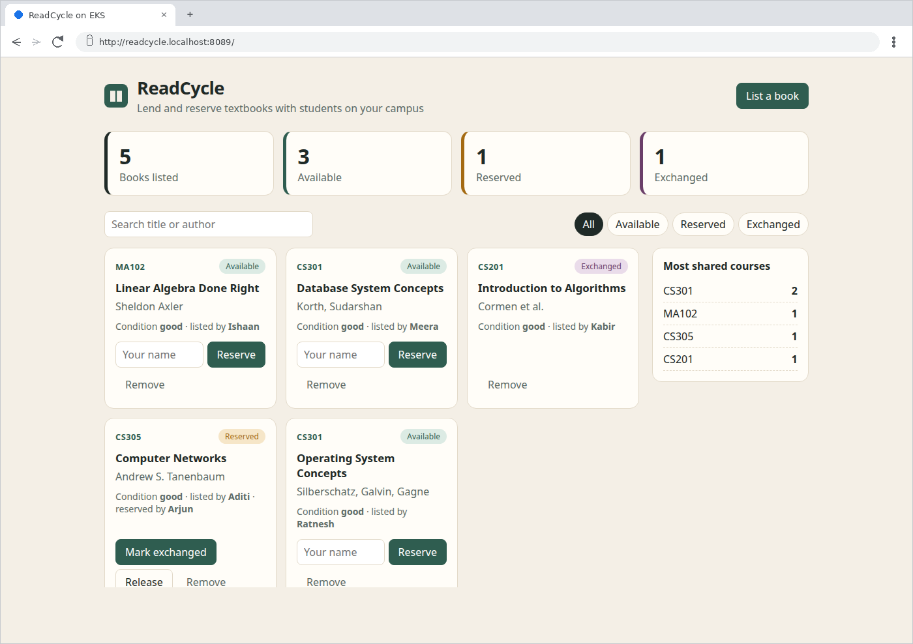

**Where to look**

| | |
|---|---|
| **Project report (PDF, 10 pages)** | [`docs/ReadCycle-Project-Report.pdf`](docs/ReadCycle-Project-Report.pdf): every module with its proof |
| **Demo video (4 min 22 s)** | [`docs/ReadCycle-Demo.mp4`](docs/ReadCycle-Demo.mp4): narrated walkthrough with captions |
| Every rubric item and its proof | [`docs/EVIDENCE.md`](docs/EVIDENCE.md) |
| Live demo script | [`docs/DEMO.md`](docs/DEMO.md) |
| Troubleshooting challenge | [`troubleshooting/README.md`](troubleshooting/README.md) |
| Teardown and cost | [`docs/TEARDOWN.md`](docs/TEARDOWN.md) |
| Self-check against `GRADING.md` | `scripts/check-submission.sh`: 46/46 pass |

## Contents

1. [Architecture](#1-architecture)
2. [Technologies](#2-technologies)
3. [Repository layout](#3-repository-layout)
4. [Application setup](#4-application-setup)
5. [Docker](#5-docker)
6. [CI/CD pipeline](#6-cicd-pipeline)
7. [DevSecOps](#7-devsecops)
8. [Terraform: AWS VPC + EKS](#8-terraform-aws-vpc--eks)
9. [Kubernetes and Helm](#9-kubernetes-and-helm)
10. [Monitoring](#10-monitoring)
11. [GitOps and the live demo](#11-gitops-and-the-live-demo)
12. [Troubleshooting](#12-troubleshooting)
13. [Screenshots](#13-screenshots)
14. [Cost and teardown](#14-cost-and-teardown)
15. [Lessons learned](#15-lessons-learned)

## 1. Architecture

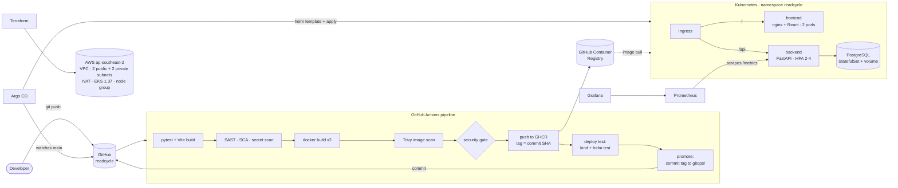

**A request:** the browser reaches the Ingress. `/` goes to the frontend (nginx serving the React
build) and `/api` goes to the backend (FastAPI), which talks to PostgreSQL. Prometheus scrapes
the backend's `/metrics` inside the cluster.

**A change:** a commit to `main` runs the pipeline. Only if every test and scan passes are the
images pushed and the new tag committed to `gitops/environments/dev/values.yaml`. Argo CD
notices that commit and rolls it out. CI never touches the cluster, and **no cloud or cluster
credentials are stored in GitHub.** Rolling back is `git revert`.

## 2. Technologies

| Area | Tools |
|---|---|
| Frontend | React 19, Vite 8, served by unprivileged nginx |
| Backend | Python 3.12, FastAPI, SQLAlchemy 2, Alembic migrations, Pydantic 2 |
| Database | PostgreSQL 17 (StatefulSet + persistent volume; in-memory SQLite in tests) |
| Tests | pytest + pytest-cov (11 tests, 95 % coverage) |
| Containers | Docker multi-stage builds, Docker Compose |
| CI/CD | GitHub Actions, GitHub Container Registry |
| Security | Bandit, Semgrep, pip-audit, npm audit, Trivy, Gitleaks, a security gate, Pod Security |
| Infrastructure | Terraform (AWS provider 6), AWS VPC, EKS 1.37, IAM, EKS Pod Identity, EBS CSI |
| Kubernetes | Helm 4 chart, ingress-nginx, HPA, metrics-server, kind for the local cluster |
| Observability | kube-prometheus-stack (Prometheus, Alertmanager, Grafana), prometheus-fastapi-instrumentator |
| GitOps | Argo CD 3.5 |

## 3. Repository layout

| Path | What it is |
|---|---|
| [`backend/`](backend/) | FastAPI app: `app/` (routes, models, schemas, DB), `alembic/` migrations, `tests/`, `Dockerfile` |
| [`frontend/`](frontend/) | React + Vite UI, `nginx/` runtime config, multi-stage `Dockerfile` |
| [`docker-compose.yml`](docker-compose.yml) | the whole stack locally: PostgreSQL, backend, frontend |
| [`.github/workflows/pipeline.yml`](.github/workflows/pipeline.yml) | the CI/CD pipeline (11 jobs) |
| [`security/`](security/) | scanner configs, checksum-verified tool installer, the security gate |
| [`terraform/`](terraform/) | AWS VPC + EKS, and the Terraform user's least-privilege IAM policy |
| [`k8s/`](k8s/) | `namespace.yaml`, the gp3 storage class for EKS, the app as plain manifests in `manifests/` |
| [`helm/readcycle/`](helm/readcycle/) | the Helm chart |
| [`monitoring/`](monitoring/) | kube-prometheus-stack values, installer, traffic generator |
| [`gitops/`](gitops/) | Argo CD Application, the dev environment's values, one-command bootstrap |
| [`troubleshooting/`](troubleshooting/) | faults to inject through Git, and the write-up |
| [`scripts/`](scripts/) | local kind cluster setup, the `GRADING.md` self-check |
| [`docs/`](docs/) | evidence (screenshots + recorded terminal sessions), demo script, teardown |

The homework's folder names map onto this layout as follows: `application/` → `backend/` +
`frontend/`, `docker/` → the two Dockerfiles + `docker-compose.yml`, `kubernetes/` → `k8s/`.
The other folders (`helm/`, `terraform/`, `.github/workflows/`, `security/`, `monitoring/`,
`gitops/`) have the same names. The layout follows the paths `GRADING.md` checks.

## 4. Application setup

| Endpoint | Purpose |
|---|---|
| `GET /api/books?status=&q=&course=` | list and search listings |
| `POST /api/books` | list a book |
| `GET` / `PUT` / `DELETE /api/books/{id}` | read, update (e.g. mark exchanged), remove |
| `POST /api/books/{id}/reserve` | reserve; `409` if it is not available |
| `GET /api/books/stats` | totals by status, most shared courses |
| `GET /api/version` | the commit the running image was built from (shown in the UI footer) |
| `GET /health`, `/ready`, `/metrics` | liveness, readiness (database reachable), Prometheus metrics |

Run the tests (no database needed; they use in-memory SQLite):

```bash
cd backend && python3 -m venv .venv && . .venv/bin/activate
pip install -r requirements-dev.txt && pytest -v
```

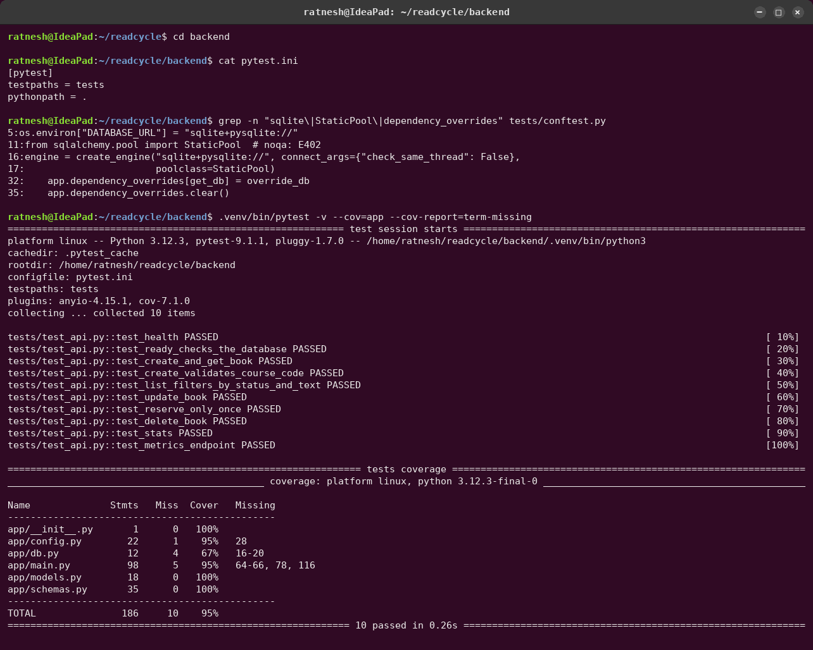

## 5. Docker

- **Backend** ([`backend/Dockerfile`](backend/Dockerfile)): two stages. Dependencies are built in
  a throw-away stage, the runtime is `python:3.12-alpine` as **uid 10001**, and database
  migrations run before the API starts.
- **Frontend** ([`frontend/Dockerfile`](frontend/Dockerfile)): **multi-stage**. Node builds the
  static files; the runtime is `nginx-unprivileged` as **uid 101**, with no Node at all. It also
  patches the OS packages (see [DevSecOps](#7-devsecops)).
- **Compose** ([`docker-compose.yml`](docker-compose.yml)): PostgreSQL with a health check; the
  backend waits for the database, and the frontend waits for the backend.

```bash
cp .env.example .env              # then set DB_PASSWORD (.env is git-ignored)
docker compose up --build         # UI: http://localhost:3000   API docs: http://localhost:8000/docs
```

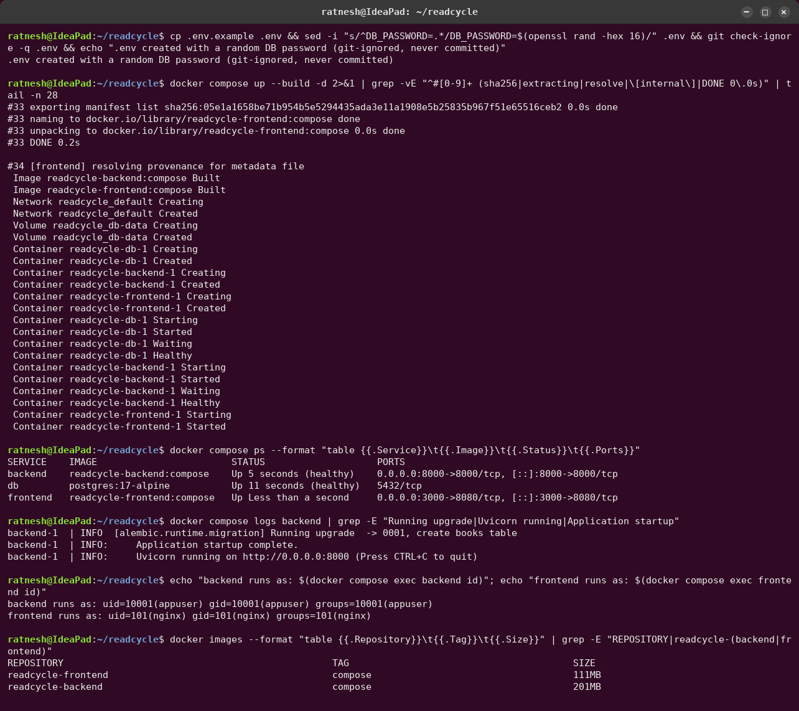

## 6. CI/CD pipeline

[`pipeline.yml`](.github/workflows/pipeline.yml) runs on every push and pull request to `main`.
Commits that only change docs or the GitOps desired state are skipped, because there's no code
to test.

```text
backend-test ─┐                    ┌─ sast ────────┐
frontend-build┴──────────────────► ├─ sca ─────────┼─► docker-build ─► image-scan ─┐
                                   └─ secret-scan ─┘                              │
                              security-gate (one policy over 8 reports) ◄─────────┘
                                   │
                                 push          both images to GHCR, tag = commit SHA
                                   │
                                 deploy-test   throw-away kind cluster: helm upgrade --install + helm test
                                   │
                                 promote       commit the tag to gitops/environments/dev/values.yaml
```

- **Tests come first.** If pytest fails, nothing is built, scanned or pushed.
- **Images are built once.** Trivy scans the exact image files that are then pushed.
- **Tags are the full commit SHA,** never `latest`. The Helm chart refuses to render without a
  tag, so a deployment always names a commit.
- **`deploy-test`** proves the chart installs into a fresh cluster and passes `helm test`.
- **`promote`** is the GitOps hand-off. It commits the new tag with `[skip ci]`, so it doesn't
  start another run.
- **Actions** are on current Node 24 versions, and the runner is pinned to `ubuntu-24.04`.

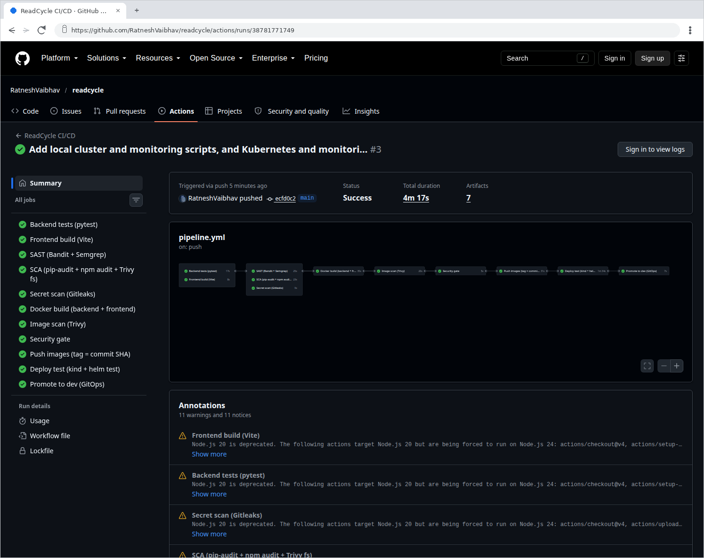
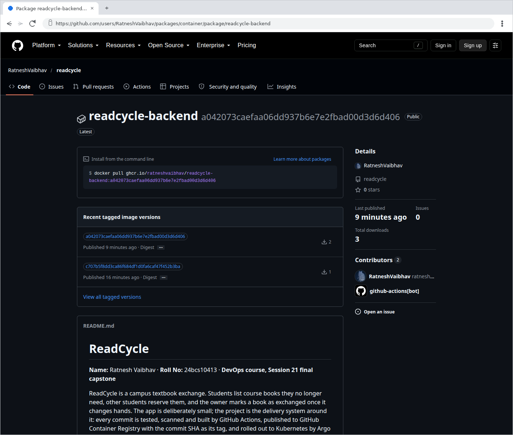

## 7. DevSecOps

| Stage | Tool | Blocks on |
|---|---|---|
| SAST | Bandit (Python), Semgrep (Python, React, 3 custom rules) | any HIGH / ERROR |
| SCA | pip-audit, npm audit, Trivy filesystem scan | any known-vulnerable package / HIGH or CRITICAL |
| Secrets | Gitleaks over the whole Git history (output redacted) | any finding |
| Images | Trivy on both images | any HIGH or CRITICAL |
| Gate | [`security-gate.sh`](security/security-gate.sh) reads all 8 reports, prints one table, fails the job | a finding or a missing report |
| Runtime | non-root images, read-only root filesystem, all capabilities dropped, seccomp, Pod Security | |

The scanners are installed at pinned versions and **verified with SHA-256 checksums**, so a
tampered download stops the pipeline.

**What Trivy found:** both published images have **0 HIGH or CRITICAL** vulnerabilities. That's
deliberate. The upstream nginx base image has **43 fixable HIGH/CRITICAL CVEs**, for example
**CVE-2026-33630**, a use-after-free / double-free in the `c-ares` DNS library (1.34.6, fixed
in 1.34.8). The frontend Dockerfile runs `apk upgrade` and removes `curl` to patch them, and the
gate stops the pipeline if one ever comes back.

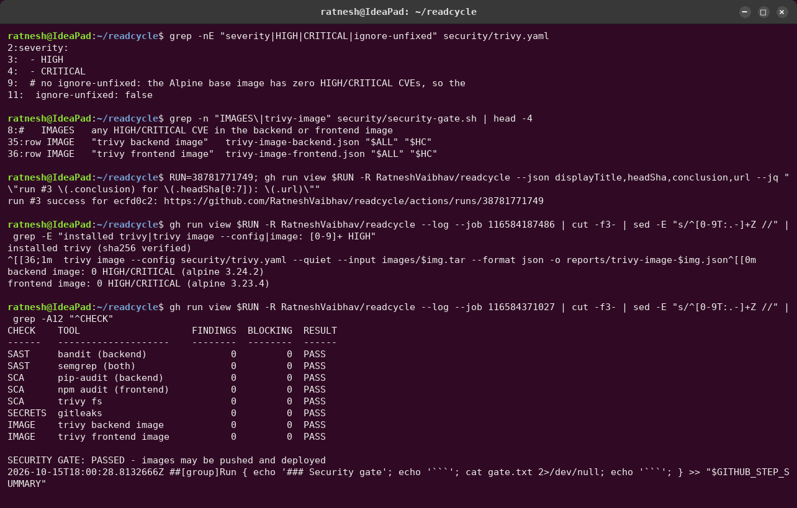
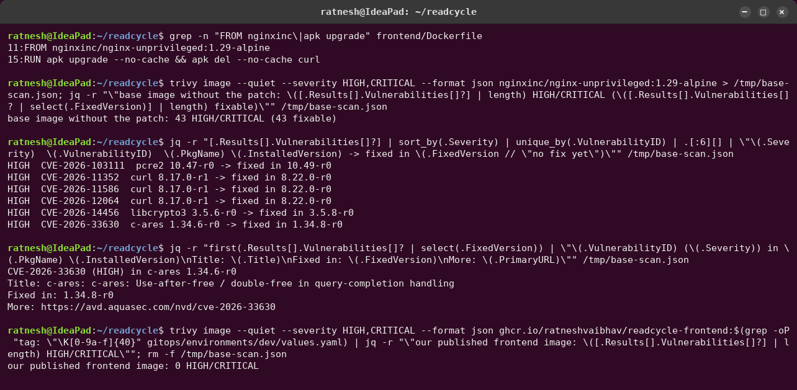

## 8. Terraform: AWS VPC + EKS

[`terraform/`](terraform/) creates **27 resources** (the first plan had 25; the Pod Identity fix added two):

- a **VPC** (`10.40.0.0/16`) with **2 public subnets** (for load balancers) and 2 private
  subnets (for the nodes), across two availability zones;
- an internet gateway, a NAT gateway and route tables;
- IAM roles;
- an **EKS 1.37** cluster with a managed **node group** (one `m7i-flex.large` node);
- the EBS CSI storage driver (with its own role through **EKS Pod Identity**) and metrics-server.

Choices made to keep it safe and free:

- **Region `ap-southeast-2` (Sydney).** The AWS account was created through AWS's new sign-up
  experience, whose AWS-managed organization policy allows EC2 and EKS only in the one region AWS
  assigned to the account. Every call in the course default `ap-south-1` was denied.
- **Free plan.** `m7i-flex.large` is on the Free plan's allowed instance list. The whole AWS
  session (about 1 h 20 min) ran on Free Tier credits; the Free plan does not bill a card.
- **`upgrade_policy = STANDARD`.** The cluster can never drift into extended support, which costs
  6× as much per hour.
- **No credentials in the repository.** Terraform ran as a least-privilege IAM user
  ([policy](terraform/iam-policy-readcycle-terraform.json): only EC2/EKS in the allowed regions,
  only `readcycle-*` roles, only the five EKS policies). Its key exists only in the local AWS
  CLI configuration. `terraform.tfvars` and state are git-ignored; only `terraform.tfvars.example`
  is committed.
- **Locked-down API.** The EKS API endpoint accepted connections only from the laptop's IP address.

```bash
cd terraform
cp terraform.tfvars.example terraform.tfvars    # set owner and your IP
terraform init && terraform plan -out=tfplan && terraform apply tfplan
aws eks update-kubeconfig --region ap-southeast-2 --name readcycle-eks
```

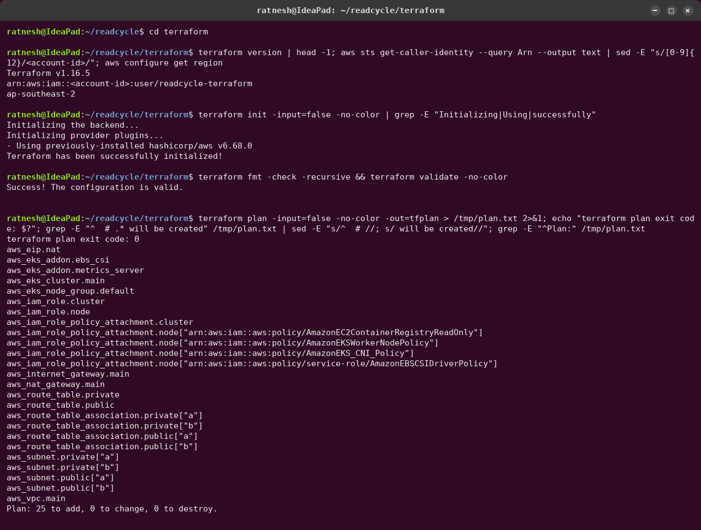
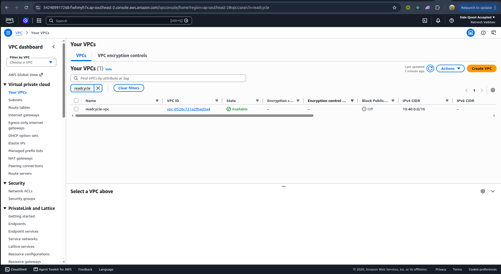
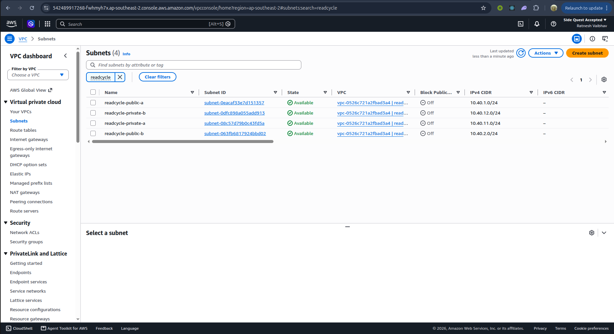
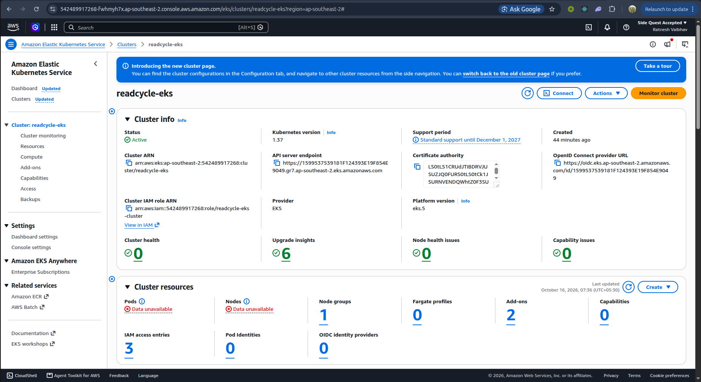
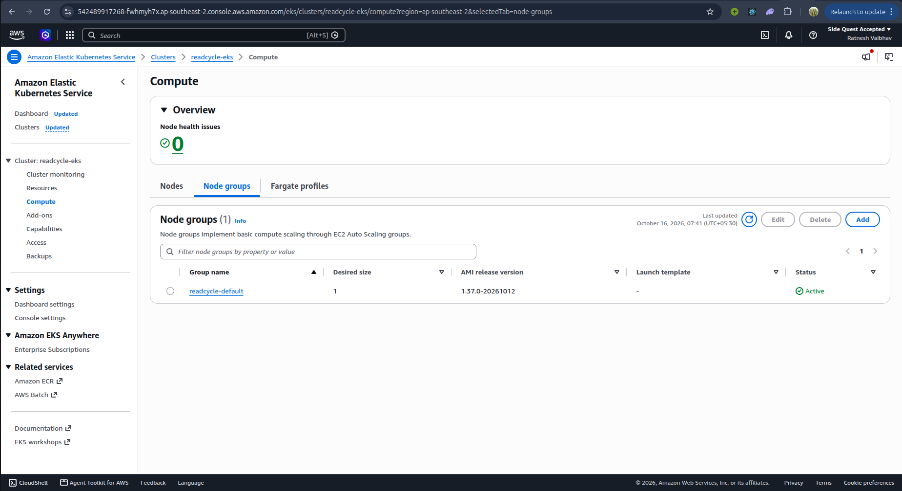

Two real failures came up during `apply`, and both are recorded with their fixes: the node group
needed an AWS service-linked role to exist first, and the storage driver needed its own
credentials through Pod Identity
([apply](docs/evidence/screenshots/m7-terraform-apply-nodegroup.png),
[fix](docs/evidence/screenshots/m7-terraform-apply-ebs-fix.png)). Everything was destroyed
afterwards:

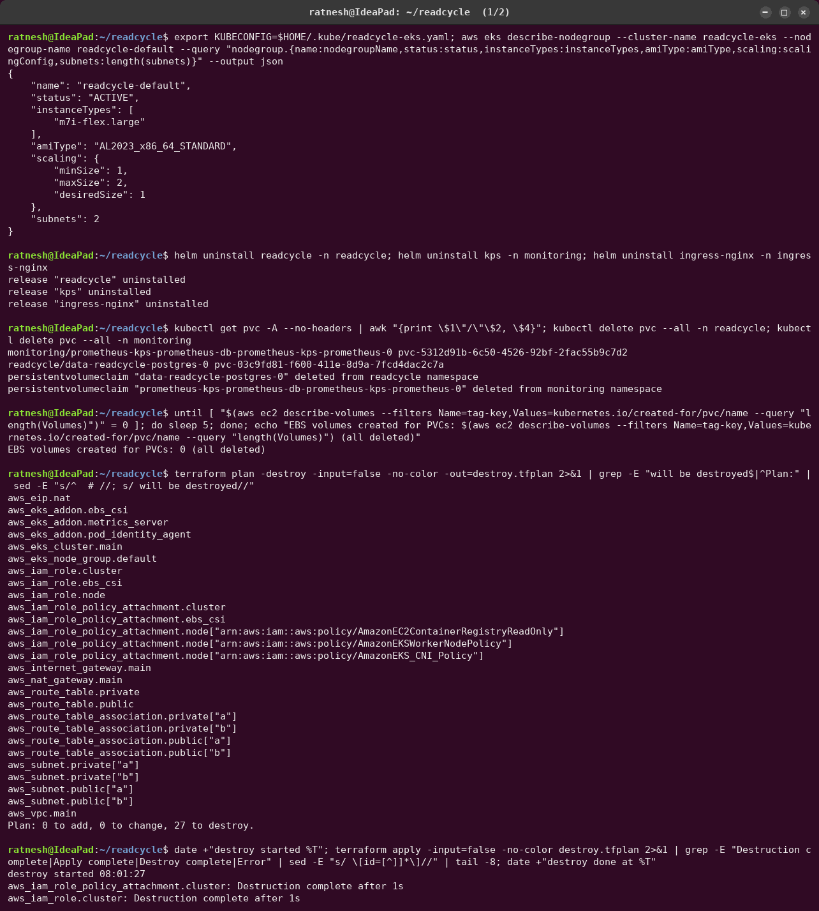

## 9. Kubernetes and Helm

The [`helm/readcycle`](helm/readcycle/) chart deploys:

- the backend (HPA 2–4 replicas, startup/readiness/liveness probes, a `wait-for-db` init
  container, a ConfigMap, and the password from a Secret that is never in Git);
- the frontend (2 replicas);
- PostgreSQL as a StatefulSet with a persistent volume;
- ClusterIP Services, and an Ingress (`/` → frontend, `/api` → backend);
- a ServiceMonitor, 4 alert rules, a Grafana dashboard, and a `helm test`.

[`k8s/namespace.yaml`](k8s/namespace.yaml) creates the namespace with Pod Security labels.

```bash
kubectl apply -f k8s/namespace.yaml
kubectl create secret generic readcycle-db -n readcycle --from-literal=password="$(openssl rand -hex 16)"
helm upgrade --install readcycle helm/readcycle -n readcycle --set image.tag=<commit SHA>
helm test readcycle -n readcycle
```

On AWS EKS, there's no AWS load balancer (it would cost money): ingress-nginx runs as a
ClusterIP service and the browser reaches it through `kubectl port-forward`. Requests still go
through the Ingress rules by hostname.

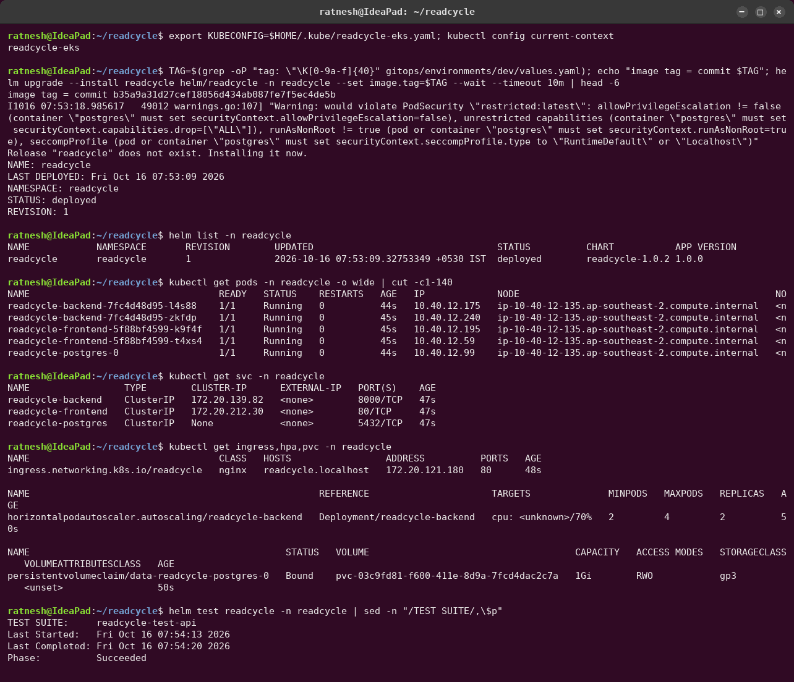
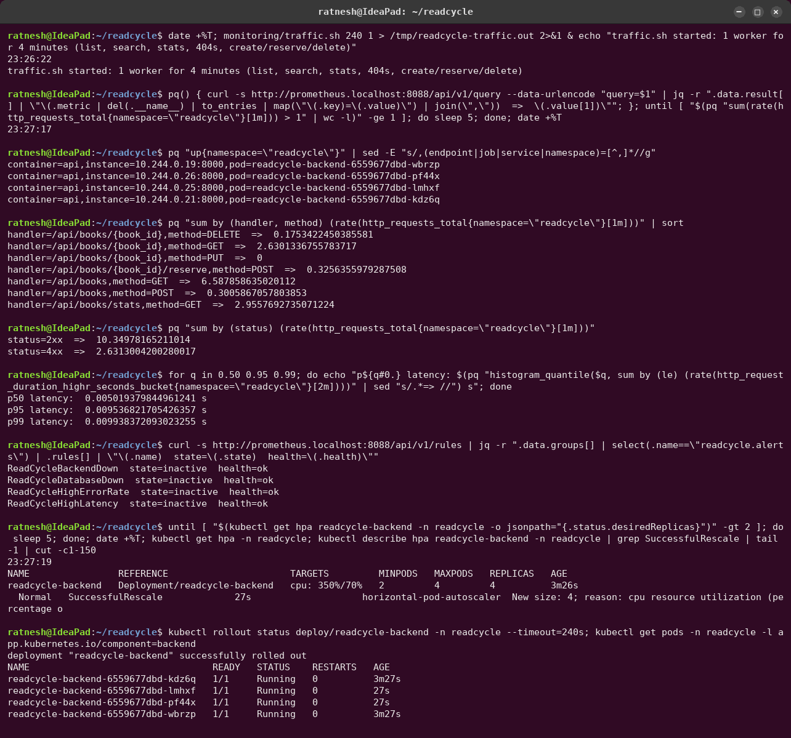

## 10. Monitoring

[`monitoring/install.sh`](monitoring/install.sh) installs kube-prometheus-stack with
[these values](monitoring/kube-prometheus-stack-values.yaml): Prometheus keeps its data on a
volume, and Grafana's admin password is random and kept in a Secret. The chart adds a
**ServiceMonitor** (scrapes `/metrics` every 15 s), **4 alert rules** (backend down, database
down, 5xx ratio, p95 latency) and a **12-panel dashboard**. The backend also writes one JSON log
line per request.

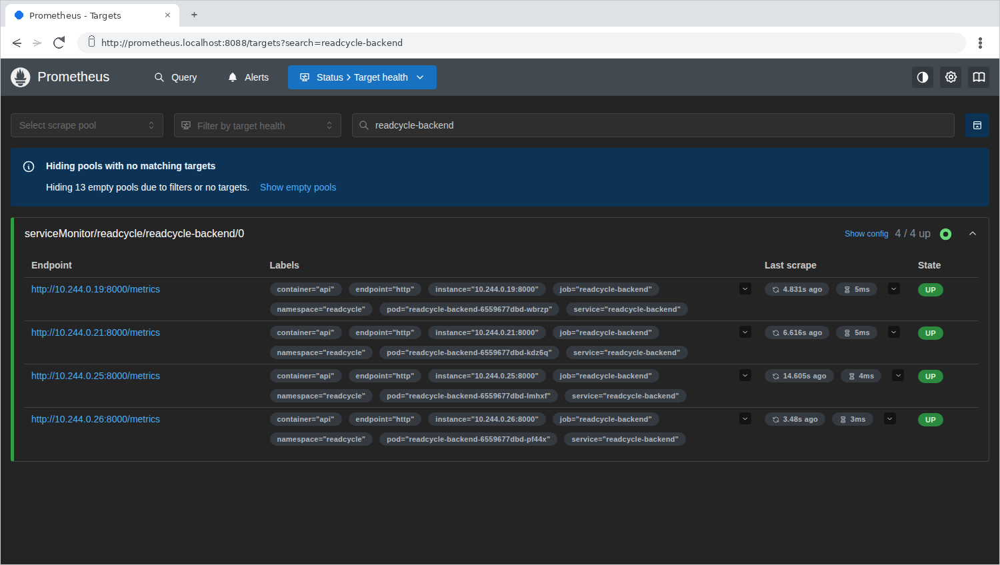
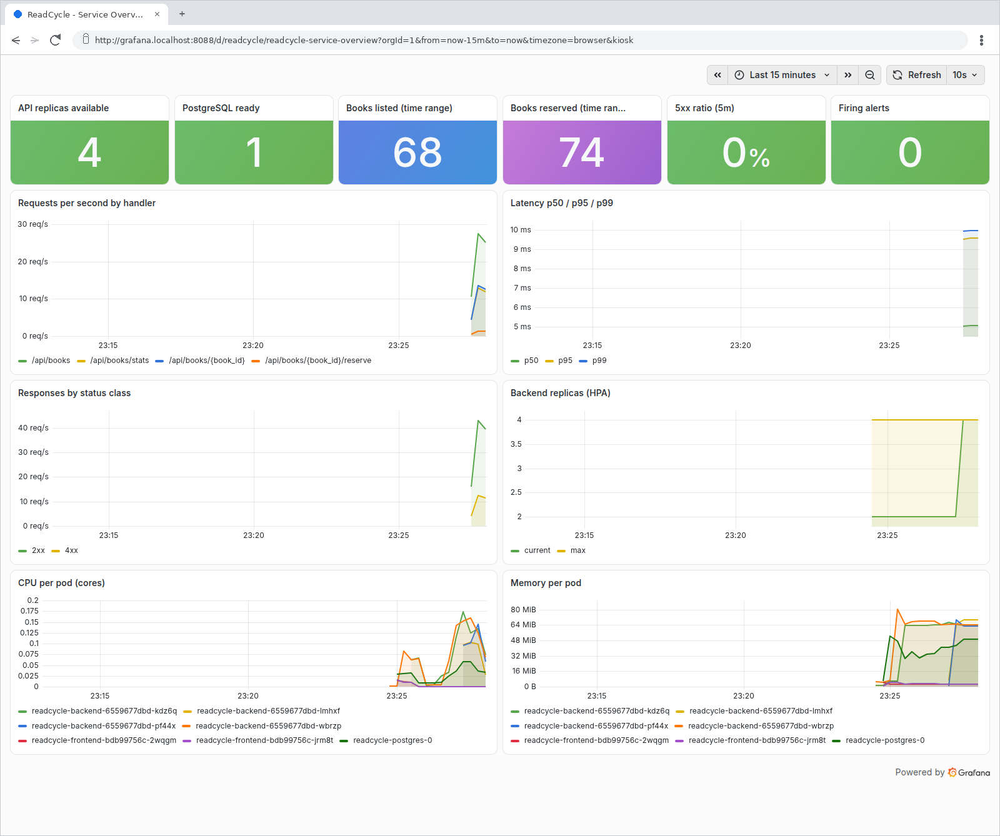

## 11. GitOps and the live demo

[`gitops/bootstrap.sh`](gitops/bootstrap.sh) prepares a cluster in one command: the namespace,
a random database password, Argo CD, and the
[Application](gitops/argocd/readcycle-app.yaml) that deploys `helm/readcycle` with
[`gitops/environments/dev/values.yaml`](gitops/environments/dev/values.yaml) from this
repository's `main` branch (automated sync, prune and self-heal).

**The live demo (M10), rehearsed and recorded:**

1. A tagline change was pushed at **08:51:45**.
2. All 11 pipeline jobs were green at **08:56:21**.
3. The pipeline's bot committed the new tag.
4. Argo CD served the new build at **08:57:34**.

The footer shows the running commit, so the change is visible in the browser. The script for the
presentation is in [`docs/DEMO.md`](docs/DEMO.md).

| Before | After |
|---|---|
| 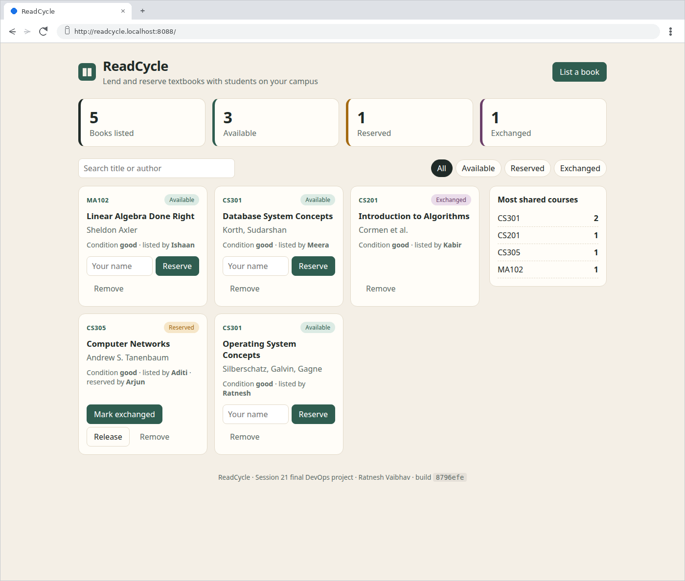 | 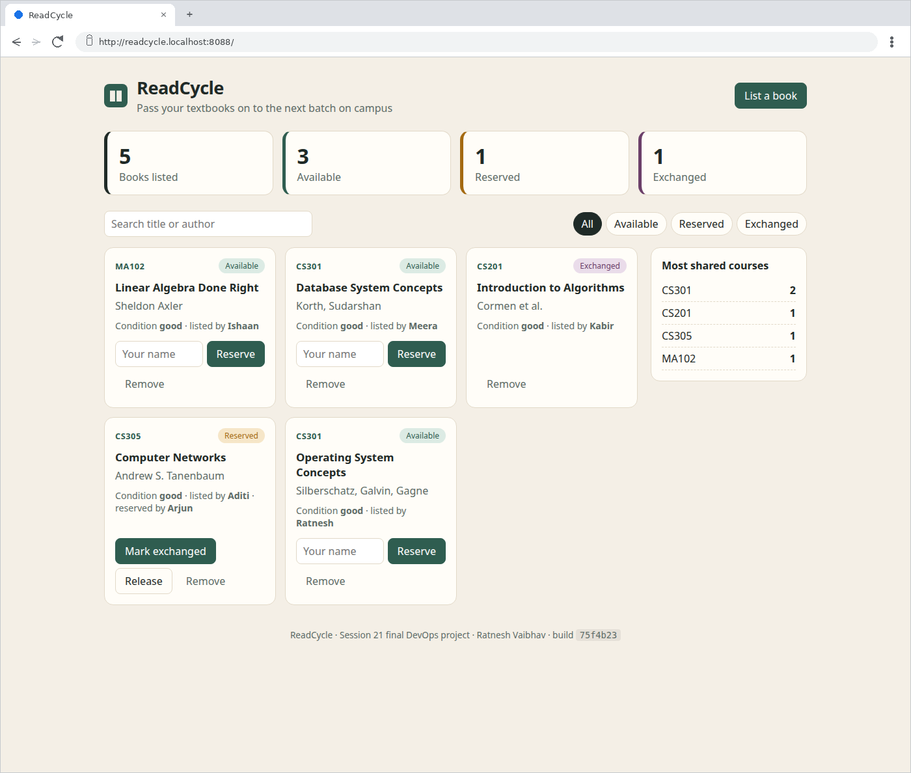 |

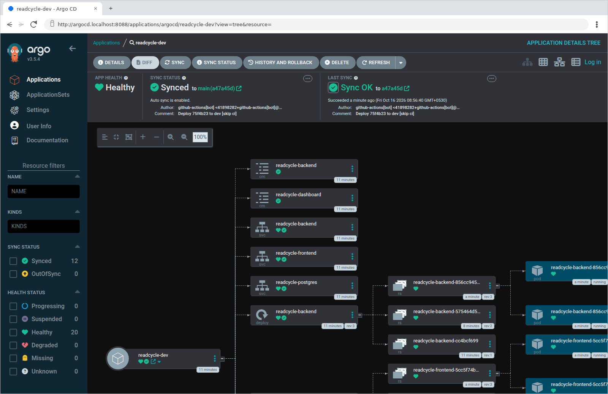

## 12. Troubleshooting

Three faults were merged as commits and deployed by Argo CD. Each was identified, investigated,
root-caused, reverted through Git and verified. Full write-up:
[`troubleshooting/README.md`](troubleshooting/README.md).

| Fault | Symptom | Root cause |
|---|---|---|
| Database user renamed | new pods crash-loop; users still served by old pods | `POSTGRES_USER` only applies to an empty data volume |
| Ingress host typo | every URL 404, while Argo CD says **Healthy** | no Ingress rule matches the hostname users type |
| Resource requests removed | HPA `<unknown>`, Argo CD **Degraded** | HPA utilisation is a percentage of the CPU request |

The write-up also covers six real problems met while building this, including AWS refusing
`aws login`, the region lock, and the two failed `apply` steps.

## 13. Screenshots

All 53 screenshots, item by item against the rubric: **[`docs/EVIDENCE.md`](docs/EVIDENCE.md)**.
Terminal screenshots are rendered from recorded sessions (each command and its real output, in
[`docs/evidence/transcripts/`](docs/evidence/transcripts/)) and can be regenerated with
`docs/evidence/tools/render_all.sh`. Browser screenshots are headless-Chrome captures showing the
URL. The AWS Console screenshots were taken by me in my AWS account.

## 14. Cost and teardown

| What | Cost |
|---|---|
| GitHub repository, Actions, GHCR | free (public repository) |
| Local Kubernetes cluster (kind) | free |
| AWS: EKS, NAT gateway, one node for ~1 h 20 min | ~$0.40 of Free Tier credits; $0 billed |

The AWS infrastructure was destroyed right after testing, and a check against AWS confirms
nothing is left: no cluster, VPC, NAT gateway, Elastic IP, instance or volume. How to tear it
down again and delete the access key: [`docs/TEARDOWN.md`](docs/TEARDOWN.md).

## 15. Lessons learned

1. **Healthy isn't working.** The Ingress typo passed every probe and Argo CD check while every
   user got a 404. Probes test pods from inside; something has to test the public URL.
2. **GitOps makes every change reviewable and reversible.** Faults, fixes and deployments are
   all commits; a rollback is `git revert`, and the cluster never drifts from Git.
3. **Pods shouldn't borrow the node's identity.** Amazon Linux 2023 blocks it on purpose; EKS
   Pod Identity gives each workload its own short-lived credentials.
4. **Read the account's rules before planning.** This AWS account allows one region and
   rejects `aws login`. Small read-only probes found that in minutes, before anything was built.
5. **Some configuration only works once.** Database init variables do nothing on an existing
   volume; changing them needs a migration.
6. **The HPA divides by the request.** No CPU request means no autoscaling.
7. **Scan what you ship.** The base image carried 43 fixable CVEs that `docker build` happily
   produced; the pipeline scans the exact files it pushes.
8. **Tear down what Terraform doesn't know about first.** Kubernetes created the EBS volumes, so
   `terraform destroy` alone would have left them behind.
