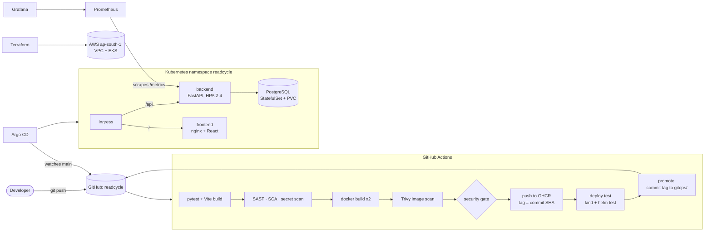

# ReadCycle

**Name:** Ratnesh Vaibhav · **Roll No:** 24bcs10413 · **DevOps course, Session 21 final capstone**

ReadCycle is a campus textbook exchange. Students list course books they no longer need,
other students reserve them, and the owner marks a book as exchanged once it changes hands.
The app is deliberately small; the project is the delivery system around it: every commit is
tested, scanned and built by GitHub Actions, published to GitHub Container Registry with the
commit SHA as its tag, and rolled out to Kubernetes by Argo CD from this repository, with
Prometheus and Grafana watching it. Terraform describes the AWS network and EKS cluster it
runs on in the cloud.

> **Status:** the code is complete; the evidence (screenshots for every rubric item) is being
> regenerated in this repository and will be linked from this README.

## Architecture



## Repository layout

| Path | What it is |
|---|---|
| [`backend/`](backend/) | FastAPI API: `app/` (routes, models, schemas, DB), `alembic/` migrations, `tests/` (pytest), `Dockerfile` |
| [`frontend/`](frontend/) | React + Vite UI, `nginx/` runtime config, multi-stage `Dockerfile` |
| [`docker-compose.yml`](docker-compose.yml) | the whole stack locally: PostgreSQL, backend, frontend |
| [`.github/workflows/pipeline.yml`](.github/workflows/pipeline.yml) | CI/CD: tests → security scans → images → GHCR → deploy test → GitOps promote |
| [`security/`](security/) | scanner configs, pinned and checksum-verified tool installer, the security gate |
| [`terraform/`](terraform/) | AWS VPC (2 public + 2 private subnets, NAT) and EKS with a managed node group |
| [`k8s/`](k8s/) | `namespace.yaml` for the release, plus the app as plain manifests in `manifests/` |
| [`helm/readcycle/`](helm/readcycle/) | Helm chart: Deployments, Services, Ingress, HPA, PostgreSQL, ServiceMonitor, alerts, dashboard, `helm test` |
| [`monitoring/`](monitoring/) | kube-prometheus-stack values (Prometheus + Grafana) and a traffic generator |
| [`gitops/`](gitops/) | Argo CD Application, the dev environment's values, one-command cluster bootstrap |
| [`troubleshooting/`](troubleshooting/) | faults to inject through Git and how to diagnose them |

## Run it locally

```bash
cp .env.example .env              # then set DB_PASSWORD in .env (git-ignored)
docker compose up --build         # UI: http://localhost:3000   API docs: http://localhost:8000/docs
```

Tests use an in-memory SQLite database, so no PostgreSQL is needed:

```bash
cd backend && python3 -m venv .venv && . .venv/bin/activate
pip install -r requirements-dev.txt && pytest -v
```

## API

| Method and path | Purpose |
|---|---|
| `GET /api/books?status=&q=&course=` | list and search listings |
| `POST /api/books` | list a book |
| `GET` / `PUT` / `DELETE /api/books/{id}` | read, update (e.g. mark exchanged), remove |
| `POST /api/books/{id}/reserve` | reserve a book (`409` if it is not available) |
| `GET /api/books/stats` | totals by status and the most shared courses |
| `GET /health`, `GET /ready`, `GET /metrics` | liveness, readiness (database reachable), Prometheus metrics |

## CI/CD in one paragraph

Every push and pull request to `main` runs the pipeline. pytest and the frontend build must
pass first; Bandit, Semgrep, pip-audit, npm audit, Trivy and Gitleaks then scan the code and
dependencies; both images are built once and Trivy scans the exact image files that will be
pushed. A security gate reads all eight reports and stops the pipeline on any HIGH or CRITICAL
finding. Only then are the images pushed to GHCR, tagged with the commit SHA. On `main`, the
chart is installed into a throw-away cluster and `helm test` must pass, and the promote job
commits the new tag to `gitops/environments/dev/values.yaml`; Argo CD sees that commit and
rolls it out. No cloud or cluster credentials are stored in GitHub.

## Cost and teardown

The AWS part runs on the AWS Free plan (credits only, no card charges) for about an hour, and
everything is destroyed afterwards with `terraform destroy`. Teardown steps will be documented
here with the evidence.
