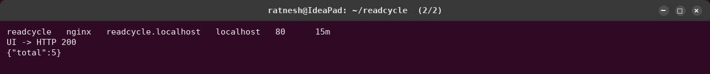

# Troubleshooting challenge

The homework's final challenge: introduce several issues on purpose, then for each one
**identify** it, **investigate** logs and resources, find the **root cause**, **fix** it,
**verify** the fix and **document** it.

Every fault here arrives the way real outages usually do: **as a commit**. The cluster is run by
Argo CD from this GitHub repository, so [`inject.sh`](inject.sh) merges a small,
harmless-looking change into
[`gitops/environments/dev/values.yaml`](../gitops/environments/dev/values.yaml) and pushes it to
`main`, exactly like a bad pull request being merged. Argo CD deploys it within a minute. The fix
goes through Git too (`git revert`), never `kubectl edit`, so the history shows who broke what
and who fixed it.

```bash
troubleshooting/inject.sh troubleshooting/01-wrong-db-user.values.yaml   # break it (commit + push)
git revert --no-edit HEAD && git push                                     # fix it (commit + push)
```

| # | The bad commit | What users / tools saw | Root cause | Broken → fixed |
|---|---|---|---|---|
| [F1](#f1--database-user-renamed) | `database.user: readcycle_app` | new backend pods crash-loop; users still served by old pods | PostgreSQL only creates the user from `POSTGRES_USER` when its data volume is **empty** | 08:59:42 → 09:00:31 |
| [F2](#f2--ingress-host-typo) | `ingress.host: readcycle.local` | **every URL returns 404 while Argo CD and all probes say Healthy** | the Ingress rule no longer matches the hostname users type | 09:02:04 → 09:03:17 |
| [F3](#f3--resource-requests-removed) | `backend.resources: null` | HPA `cpu: <unknown>`, Argo CD **Degraded** | the HPA's target is a % of the CPU **request**; no request, nothing to divide by | 09:04:41 → 09:06:28 |

**The method, the same every time**

1. **Symptom:** what does the user see (`curl`), and what does Argo CD say (`argocd app get`)?
2. **Resources:** `kubectl get pods`, `kubectl describe`, `kubectl get events`.
3. **Logs:** `kubectl logs <pod> --previous` for crashed containers; the ingress controller log for routing.
4. **The wrong object:** compare what runs with what should run (ConfigMap, Ingress, HPA, pod spec).
5. **The commit:** `git log` on the GitOps values file shows which change did it.
6. **Fix and verify:** `git revert`, wait for Argo CD to sync, repeat step 1.

---

## F1 — Database user renamed

**The bad commit** renames the database user to `readcycle_app`, a "tidy-up" that looks
harmless in review.


- **Identify:** Argo CD applied the commit and one new backend pod went into
  `CrashLoopBackOff`. Users noticed nothing, because the rolling update keeps the old pods
  serving until a new pod is ready. That safety net is also why such faults are easy to miss.
- **Investigate:** the crashed container's log (`--previous`) says
  `FATAL: password authentication failed for user "readcycle_app"`. The ConfigMap has the new
  name. The PostgreSQL log says it **skipped initialization**, and `pg_roles` contains only
  `readcycle`.
- **Root cause:** the official PostgreSQL image creates the user from `POSTGRES_USER` only when
  `initdb` runs on an **empty** data volume. The volume already holds the database, so the
  rename created nothing.
- **Fix and verify:** `git revert`. Argo CD rolled back within 20 s; all pods are Running and
  the data is intact. A real rename would need a migration (`ALTER ROLE ... RENAME`), not a
  values change.

## F2 — Ingress host typo

**The bad commit** changes the Ingress host to `readcycle.local`.




- **Identify:** the dangerous kind of failure. **Argo CD says Synced and Healthy, every probe
  passes, and every user gets `404 Not Found`.** Probes check pods from inside the cluster;
  nothing was checking the public URL.
- **Investigate,** following the request from the outside in:
  1. `curl` gets a 404 page from nginx, so the request reaches the ingress controller.
  2. Pods are ready and endpoint slices have addresses, so the Services and pods are fine.
  3. `kubectl get ingress` shows the host `readcycle.local`.
  4. A request with `Host: readcycle.local` works, so the routing rule is wrong, not the app.
  5. The request for the real hostname isn't even in the access log: ingress-nginx's catch-all
     server has `access_log off`. **A request missing from the log means no rule matched its
     host.**
- **Root cause:** the commit changed `ingress.host`, and the hostname users type no longer
  matches any rule.
- **Fix and verify:** `git revert`. The Ingress is back on `readcycle.localhost` and the UI and
  API return 200. To catch this next time: a smoke test against the public hostname after every
  deployment.

## F3 — Resource requests removed

**The bad commit** "simplifies" the backend by deleting its `resources` block.


- **Identify:** the app kept working, but the HPA showed `cpu: <unknown>/70%`, and Argo CD
  marked the whole application **Degraded** because of the HPA.
- **Investigate:** `kubectl describe hpa` →
  `ScalingActive False FailedGetResourceMetric: missing request for cpu`. The pods'
  `resources` are `{}`.
- **Root cause:** `targetCPU: 70` means 70 % **of the CPU request**. Without a request there
  is nothing to divide by, so the HPA can never scale. Dropping the block also dropped the
  memory limit, so one leaking pod could exhaust the node.
- **Fix and verify:** `git revert`. The HPA reports `cpu: 7%/70%` with `ValidMetricFound`, and
  Argo CD is Healthy. To prevent it: a `LimitRange` with default requests, or a policy that
  rejects pods without requests.

---

## Real problems met while building it

These weren't injected. Each was diagnosed the same way, fixed, and recorded:

| Problem | How it showed | Root cause | Fix | Evidence |
|---|---|---|---|---|
| `aws login` refused | AWS sign-in page: "Something went wrong … appeal" | the account comes from AWS's new sign-up experience, which blocks that sign-in flow | a least-privilege IAM user with an access key, typed into `aws configure` locally ([policy](../terraform/iam-policy-readcycle-terraform.json)) | — |
| Every EC2/EKS call denied in Mumbai | `explicit deny in a service control policy` | AWS manages this account's organization policy and allows **one** assigned region (Sydney) | Terraform and the CLI target `ap-southeast-2` | [plan](../docs/evidence/screenshots/m7-terraform-plan.png) |
| EKS node group not created | `InvalidRequestException: Failed to validate if SLR … missing permissions for 'iam:GetRole'` | the node-group service-linked role didn't exist yet; for a role that doesn't exist, IAM checks the path-less ARN, which the policy didn't cover | create the service-linked role first | [apply](../docs/evidence/screenshots/m7-terraform-apply-nodegroup.png) |
| EBS CSI driver crash-looping, add-on stuck `CREATING` | `no EC2 IMDS role found … context deadline exceeded` | Amazon Linux 2023 nodes keep pods away from the instance metadata service, so pods can't borrow the node role | **EKS Pod Identity**: the driver gets its own role (`readcycle-ebs-csi`) | [fix](../docs/evidence/screenshots/m7-terraform-apply-ebs-fix.png) |
| Postgres pod would be rejected | server-side dry run: violates Pod Security `restricted` | the official image starts as root | namespace enforces `baseline`, warns on `restricted` | [`k8s/namespace.yaml`](../k8s/namespace.yaml) |
| Argo CD briefly "Degraded" right after each rollout | app health Degraded for about a minute | new pods have no CPU metrics yet, so the HPA can't compute utilisation for a moment | none needed; it clears by itself (good to know before a live demo) | [Argo CD](../docs/evidence/screenshots/web-m10-4-argocd-synced.png) |

The first version of this project, built in a lab repository, hit five more incidents (a frontend
OOMKilled under node memory pressure, an ingress admission webhook outage, a load test that took
the node down, a dashboard reading 0 after counter resets, and Prometheus losing its history).
They're written up in the
[Session 21 lab write-up](https://github.com/RatneshVaibhav/Devops-Assignments/blob/main/session-21-final-devops-project/final-devops-project/troubleshooting/README.md);
their fixes are part of this chart and monitoring configuration.
